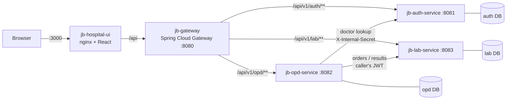

# Jeevan Bikas Hospital · OPD & Laboratory

A microservice system for a hospital outpatient department: the patient is registered at the front desk, a nurse records vitals, the doctor consults and can order lab tests, the lab enters results, and the doctor signs the visit off. Every step is audited.



| Service | Responsibility | Stack |
|---|---|---|
| `jb-auth-service` | Staff accounts, login, JWT issuing, doctor directory | Spring Boot 3.3, Spring Security, JPA, Flyway |
| `jb-opd-service` | Patients, visits, daily tokens, triage vitals, consultation workflow, lab-report PDF | Spring Boot 3.3, WebClient, OpenPDF |
| `jb-lab-service` | Test catalogue, lab orders, result entry with reference-range flagging | Spring Boot 3.3 |
| `jb-gateway` | Single entry point and routing | Spring Cloud Gateway |
| `jb-hospital-ui` | Role-based web app | React 19, TypeScript, Tailwind v4, Vite |

Each service owns its own Postgres database (database-per-service). Services verify the same HS256 JWT, so there is no per-request call to the auth service.

## Run it

```bash
docker compose down -v          # first time after upgrading: start from clean databases
docker compose up --build
```

Open **http://localhost:3000**. The auth service seeds one account per role on first start (all with password `Demo@1234`); the login page has one-click buttons for them.

| Username | Role | Lands on |
|---|---|---|
| `nurse` | Nurse | Registration, Triage |
| `doctor` | Doctor (Dr. Ramesh Sharma, General Medicine) | My patients |
| `drkarki` | Doctor (Dr. Anjali Karki, Cardiology) | My patients |
| `labtech` | Lab technician | Laboratory |
| `admin` | Administrator | Registration, Triage, Laboratory, Staff |

Secrets and DB passwords have local-demo defaults in `docker-compose.yml`; copy `.env.example` to `.env` to override them. Set `APP_SEED_DEMO_USERS=false` outside a demo.

## Five-minute demo script

1. **Nurse** → Registration. Register a new patient with an allergy, set priority *Urgent*, pick *Dr. Ramesh Sharma*. A token is issued and the patient appears in *Today's register*.
2. Click **Record vitals now**. Type a temperature of 38.4 and a pulse of 108; the fields flag *Fever* and *Tachycardia* as you type. Save.
3. **Doctor** (`doctor`). The patient is in *To see*, above normal-priority patients, with an *Allergy* badge. Open them: the allergy banner, flagged vitals and the visit timeline are all there.
4. Tick *CBC* and *Urinalysis*, add a clinical note, **Send to lab**. The patient moves to *At lab*.
5. **Lab tech**. The order shows the patient's name and the doctor's note. Click **CBC**, then **Collect CBC sample**; the order shows *1 of 2 collected* and *Enter results* stays locked. Do the same for **URINE**, then **Enter results**. Values outside the reference range are flagged *High*/*Low* live. **Release results**.
6. **Doctor** again. The patient is back in *To see* as *Results ready*. Review the flagged results, open the **PDF report**, enter a diagnosis and **Complete visit**. The timeline shows every step with who did it and when.
7. Bonus: log in as `drkarki`. Dr. Sharma's patients are not visible, and the API refuses (403) if you try to act on them.

## API overview

All routes go through the gateway at `:8080`. Errors are RFC 7807 `application/problem+json` with a readable `detail`.

| Method & path | Role | Purpose |
|---|---|---|
| `POST /api/v1/auth/login` | public | Returns `accessToken`, `role`, `fullName` |
| `POST /api/v1/auth/register` | ADMIN | Create a staff account |
| `GET /api/v1/auth/doctors` | NURSE, DOCTOR, ADMIN | Doctor picker |
| `POST /api/v1/opd/patients` | NURSE, ADMIN | New patient + first visit + token |
| `GET /api/v1/opd/patients?q=` | NURSE, DOCTOR, ADMIN | Search by MRN, phone or name |
| `POST /api/v1/opd/visits` | NURSE, ADMIN | New visit for a returning patient |
| `GET /api/v1/opd/visits/today` · `/triage-queue` | NURSE, ADMIN | Worklists |
| `POST /api/v1/opd/triage/vitals` | NURSE, ADMIN | Record vitals (REGISTERED → TRIAGED) |
| `GET /api/v1/opd/visits/doctor/queue?status=` | DOCTOR | The caller's own patients |
| `POST /api/v1/opd/visits/{id}/start-consultation` · `/send-to-lab` · `/conclude` | DOCTOR (assigned) | Consultation workflow |
| `GET /api/v1/opd/visits/{id}/events` | NURSE, DOCTOR, ADMIN | Audit timeline |
| `GET /api/v1/opd/visits/{id}/lab-results` · `/lab-report` | DOCTOR, ADMIN | Results JSON / PDF |
| `GET /api/v1/lab/tests` · `/tests/parameters?codes=` | LABTECH, DOCTOR, ADMIN | Catalogue and reference ranges |
| `GET /api/v1/lab/orders/queue?status=` | LABTECH, ADMIN | Lab worklist |
| `POST /api/v1/lab/orders/{id}/tests/{testCode}/collect` | LABTECH | Collect the sample for one test; the order becomes SAMPLE_COLLECTED when every test is collected |
| `PATCH /api/v1/lab/orders/{id}/status` | LABTECH | Cancel an open order |
| `POST /api/v1/lab/orders/{id}/results` | LABTECH | Save all results and complete the order in one transaction (409 until every sample is collected) |

### Visit lifecycle

```
REGISTERED ──vitals──▶ TRIAGED ──open──▶ IN_CONSULTATION ──sign off──▶ COMPLETED
                                             │        ▲
                                    send to lab        results released, doctor re-opens
                                             ▼        │
                                        AWAITING_LAB ──▶ LAB_RESULTS_READY
```

## Tests

| Where | Command | What it covers | Needs |
|---|---|---|---|
| Each Spring service | `mvn test` | Unit tests (`*Test`): visit state machine, token issuing, triage alerts, per-test sample collection, result flagging, login and registration rules, migration-file guard | JDK 17 |
| Each Spring service | `mvn verify` | The above **plus** integration tests (`*IT`): the whole service over HTTP on a real PostgreSQL 15 via Testcontainers. Flyway runs every migration, then role rules, worklist SQL, constraints and the race-free token counter are exercised | Docker running |
| Gateway | `mvn verify` | Routing by path prefix and stripping `X-Internal-Secret` from outside traffic (against stub backends) | JDK 17 |
| UI | `npm test` / `npm run coverage` | Vitest + Testing Library: API client (token header, 401 sign-out), session restore, role guard, login form, lab worklist chip-then-collect flow, vital-sign thresholds | Node 22 |
| Whole stack | `scripts/smoke-test.sh` | After `docker compose up`: logs in as each role through nginx → gateway and checks 200/401/403 answers plus a real patient registration | curl |

Integration tests are skipped automatically (not failed) when Docker isn't available, so `mvn verify` still works on a machine without it.

## Continuous integration

`.github/workflows/ci.yml` runs on every push to `main` and every pull request:

1. **backend**: `mvn verify` for each of the four Spring projects in parallel (unit + Testcontainers tests). Test reports are uploaded when something fails.
2. **frontend**: `npm ci`, lint, type-check, tests with coverage, production build.
3. **e2e**: after both pass, builds every Docker image, starts the stack with `docker compose up` and runs `scripts/smoke-test.sh` against it; service logs are printed if it fails.

The workflow expects this folder to be the repository root (it sits next to `docker-compose.yml`). Deployment (the "CD" half) is not wired yet; see the note at the end of CHANGES.md.

## Local development

```bash
# databases only
docker compose up -d auth-postgres-db opd-postgres-db lab-postgres-db
# each service (defaults point at the compose DB ports 5431/5455/5456)
export APP_JWT_SECRET=dGhpcy1pcy1hLXN1cGVyLXNlY3VyZS1hbmQtbG9uZy1zZWNyZXQta2V5LWZvci1qc29uLXdlYi10b2tlbnM=
export INTERNAL_SERVICES_SECRET=local-secret
cd jb-auth-service && mvn spring-boot:run
# running OPD and the gateway outside Docker: point them at localhost
export AUTH_SERVICE_URL=http://localhost:8081 LAB_SERVICE_URL=http://localhost:8083 OPD_SERVICE_URL=http://localhost:8082
# UI
cd jb-hospital-ui && npm ci && npm run dev
```

See [CHANGES.md](CHANGES.md) for what changed in this revision.
